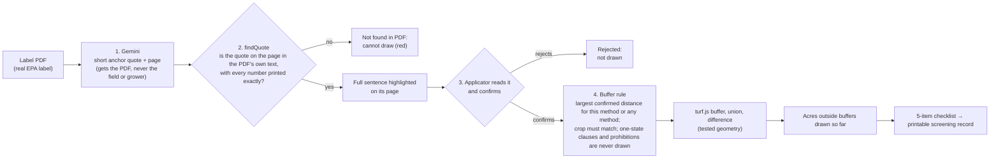

# LabelLine: pitch deck (CodeRED: Orion)

**Prizes this pitch serves:** Best Pitch/Demo, Best Environment Hack and Best Overall.
**Slot length:** {{PITCH_SLOT_LENGTH}}. The organisers have not published one.
**Format:** {{DEMO_FORMAT}}. The Demo criterion says "in-person", but Devpost lists the event as Online. The user is asking the organisers how remote teams demo (RULES.md, open question 1).
**Presenter:** {{PRESENTER_NAME}}, solo. The presenter speaks and drives the demo.

**Gate 0 applies here too.** No Gemini call has run yet, so no real reveal frame exists and the live demo can't run (VIDEO_SCRIPT.md, "Gate 0"). Slides 1 and 4 need a LIVE or REPLAY run.

**The line to remember:** "Label tools tell you what the label says. LabelLine shows where: every no-spray zone on your field is drawn from a sentence it highlights on the page."

## One run of show

The live demo is **Script A in `VIDEO_SCRIPT.md`**, with its staging: the extraction is already on screen before the judges arrive, the 150 ft clause is left pending, and the demo opens on the reveal. This deck has no demo script of its own. Its slides cover what the app can't show: the business case, what's next, and a backup when the app can't run.

| Situation | What to run | Length |
|---|---|---|
| Slot of 2:30 or less | Script A alone, beats 1–9. Its close carries the line to remember | 2:30 |
| Slot of 3:00 | Script A beats 1–8 (to 2:15), then slide 5 and slide 6. Slide 6 replaces beat 9 | 2:50 |
| No working app, or the format wants slides only | Slides 1–6 in order. Show Script B's video at slide 1 if the format allows it | 1:50 without the video |
| Expo, or a judge arriving mid-sentence | "The 60-second version" below | 1:00 |

Keep the slides open in a second window and switch to them with Alt+Tab. In a remote call, share the whole screen.

## Where every number in this deck comes from

Any number not in this table stays off the slides.

| Number | Source | Status |
|---|---|---|
| "This pesticide is extremely toxic to fish and aquatic invertebrates." | Brigade 2EC label, EPA Reg. No. 279-3313, PDF p. 4 (pdf.js 1-based) | Printed on the label |
| 25 ft ground, 150 ft non-ULV aerial, 450 ft ULV aerial; 15 mph wind limit; the list "lakes, reservoirs, rivers, streams, marshes, ponds, estuaries, and commercial fish ponds" | Brigade 2EC, PDF p. 7 (bundled sample from EPA PPLS) | Printed on the label |
| "Use of ultra-low volume (ULV) application on corn is prohibited." | Brigade 2EC, PDF p. 10 | Printed on the label |
| Brigade 2EC is 35 PDF pages | pdf.js opened it (LOG.md, cycle 1) | Measured |
| 117.7-acre sample field | turf area of `public/demo/fields/el-campo-sample.geojson` (LOG.md, cycle 3) | Measured. The field is a sample outline, not a real farm |
| About 1,560 aerial application businesses in the US | NAAA press release "NAAA Releases 2019 Aerial Application Industry Survey Results", May 22, 2019 (survey fielded Jan 26 – Apr 29, 2018) | **NAAA's estimate**, not ours. Write "est." on the slide |
| {{MINUTES_BY_HAND}} → {{MINUTES_IN_LABELLINE}} minutes to find and map Brigade 2EC's water clauses | Only from a real timed run: the presenter, by hand, then in LabelLine | **Not measured yet.** Call it one person's estimate. If not timed, drop the line |
| 307 automated tests in 22 files, all passing | `npm test`, re-run 2026-10-11 05:18 UTC+8 (code at a60b44a) | Measured. Re-run before the pitch and update the number if it changes |
| 129 annotated answer-key quotes on 6 real labels, each found on its page by the app's own quote check | `eval/answer-key.json`, `tests/eval.answerkey.test.ts` | Measured. Compiled by AI agents, machine-checked, **not reviewed by a pesticide-label expert** |
| 55 keyed distance and wind restrictions plus 3 keyed crop bans | Recall denominators in `eval/score.ts` | Counted from the key |
| {{RECALL}}, {{PRECISION}}, {{VERIFIED_RATE}}, {{CROP_BANS}}, {{LABELS_SCORED}} | `eval/results.json`, written by `npm run eval` | **Not measured yet.** It needs replay recordings made with a Gemini key |
| {{ACRES_OUTSIDE_AERIAL}} | Read off the real reveal frame | Fill in from the screenshot you actually use |
| About 900 drift reports to the Texas Department of Agriculture (TDA), 2013–2016; in 169, people said they were involuntarily exposed | Texas Observer, "Death From Above", Christopher Collins, April 17, 2017, reporting TDA figures | External, sourced. **Q&A only, not on a slide.** These reports cover drift onto people, crops and property generally, not only water; never say LabelLine would have prevented them |

A sanity check for the acres placeholder: the cycle 2 geometry check (LOG.md) used the dated water cache for the sample field. With 150 ft it left 110.26 of 117.67 acres outside the buffers. That check fed answer-key distances into the geometry by hand; no extraction was involved. If the live water returns different features, the screen will differ, and the screen wins.

## The six slides

### Slide 1: The reveal (0:15)

*In a live pitch, skip this slide: start in the staged app with Script A beat 1.*

- **Title:** The sentence becomes the no-spray zone.
- **Visual:** {{REVEAL_SCREENSHOT}}, full width. It must be a real screenshot of one frame:
  - left: Brigade 2EC, p. 7, with the 150 ft sentence highlighted;
  - centre: the red 150 ft zone along the river on the sample field, with the pointer on the zone so the linked sentence is lit;
  - header: the LIVE or REPLAY badge and the acres readout visible.
- **Caption:** "Brigade 2EC, PDF p. 7 → a 150 ft aerial no-spray zone on the 117.7-acre sample field: {{ACRES_OUTSIDE_AERIAL}} acres outside buffers drawn so far. Extraction: {{EXTRACTION_MODE}}. Sample field near El Campo, TX."
- **Screenshot rules:**
  - It must come from a LIVE or REPLAY extraction.
  - **Never use a `*-fixture-*` frame from `hackathon/screens/`.** Those frames show clauses injected through devtools, not Gemini output.
  - If the badge says REPLAY, the caption says REPLAY.

**Speaker notes:**
> "This sentence on page 7 of a real EPA pesticide label is this red strip on the field. Every zone LabelLine draws points back to the sentence that made it."

### Slide 2: Why the water matters (0:20)

*In a live pitch, Script A beat 2 says this while you hover the zone.*

- **Title:** Page 4: extremely toxic to fish. Page 7: how far to stay from water.
- **Visual:** two tight crops of the real Brigade 2EC PDF, rendered from the file:
  - p. 4, highlighted: "This pesticide is extremely toxic to fish and aquatic invertebrates."
  - p. 7, three highlighted sentences that read the same except for the number: "Do not apply within **25** / **150** / **450** feet of aquatic habitats (such as, but not limited to, lakes, reservoirs, rivers, streams, marshes, ponds, estuaries, and commercial fish ponds)."
- **Big numbers, one line:** 25 ft ground rig · 150 ft plane · 450 ft ULV (ultra-low-volume) plane.
- **Footer:** Brigade 2EC, a pyrethroid insecticide, EPA Reg. No. 279-3313, PDF pp. 4 and 7 of 35. Real label from EPA's Pesticide Product Label System.

**Speaker notes:**
> "Page 4 of this label says the product is extremely toxic to fish and aquatic invertebrates. Page 7 says how far to stay from water, by how you spray: 25 feet for a ground rig, 150 for a plane, 450 for ultra-low-volume spraying from the air. Those are sentences in a 35-page PDF. LabelLine draws page 7 on your field."

### Slide 3: User and moment (0:15)

*In a live pitch, Script A beats 2 and 7 carry the two moments.*

- **Title:** The evening before the job, and 5:30 the next morning.
- **Who:** a commercial aerial application business in Texas, spraying a field beside a river.
- **Two moments, side by side:**
  - **The evening before, at the desk:** a work order arrives for this field and this product. LabelLine reads the label, maps the water and draws the no-spray zones.
  - **5:30 AM, on site:** the wind is measured, the field edge is checked for water the map missed, and the record is closed.
- **Before → after**, two columns:

  | Before | With LabelLine |
  |---|---|
  | The distances are sentences in a 35-page PDF (p. 7 of 35 on this label) | Each distance is highlighted on its page, with the page number |
  | Nothing we found turns those sentences into geometry on this field | The zones are drawn around mapped water (the USGS stream map and the USFWS wetland map) and around water the applicator adds |
  | Federal water maps miss some ponds and ditches (the wetland map leaves out farmed wetlands) | The map says "mapped (incomplete)", and "Water the map misses?" adds them |
  | Nothing we found ties a buffer to the label sentence and page it came from | A five-item checklist and a printable, dated screening record with every quote and page |
  | {{MINUTES_BY_HAND}} min by hand on Brigade 2EC | {{MINUTES_IN_LABELLINE}} min in LabelLine (one person's estimate; drop the row if not timed) |

- **Visual:** the sample field on aerial imagery, beside the Tres Palacios River, labelled "Sample location: near El Campo, Wharton County, TX".
- **Small print:** "Scenario from desk research. We have not interviewed an applicator yet."

**Speaker notes:**
> "Picture an aerial application business in Texas. The evening before a job, the work order names this field and this product. That's when LabelLine reads the label and draws the zones. At 5:30 the next morning, on site, the crew measures the wind, checks the field edge for water the map missed, and closes the record."

### Slide 4: How trust works (0:25)

*In a live pitch, Script A beat 8 covers the proof; keep this slide for questions.*

- **Title:** A zone is drawn after four checks pass, never before.
- **Diagram** (build it as a slide graphic in the product's colours):

  The same chain as text, for a slide without Mermaid: **PDF → Gemini quote + page → found on the page with the same numbers? (no: red, never drawn) → applicator confirms → buffer rule → turf geometry → acres outside buffers drawn so far → checklist → screening record.**

- **Proof column, on the right:**
  - 307 automated tests in 22 files pass (`npm test`).
  - Answer key: 129 quotes on 6 real labels, each found on its page by the same check the app runs. Compiled by AI agents; not yet reviewed by a pesticide-label expert.
  - Measured extraction on {{LABELS_SCORED}} of the 6 labels: recall {{RECALL}}, precision {{PRECISION}}, quotes found in PDF {{VERIFIED_RATE}}, crop bans {{CROP_BANS}} of 3.
  - If the federal water service fails, the screen never says "no water". The sample field falls back to a dated cache labelled "cached"; any other field shows "Mapped layers unavailable — add observed water".

**Speaker notes:**
> "Here's why you can trust the strip. Gemini reads the whole label and has to copy a short quote and its page. LabelLine then searches the PDF's own text for that quote, and every number must match exactly. If it isn't there, the clause turns red and can never draw. If it is, the applicator reads the highlighted sentence and confirms it. Only then does the geometry run, in tested code. Against 55 keyed distance and wind restrictions on {{LABELS_SCORED}} of six real labels, extraction recall is {{RECALL}} and precision is {{PRECISION}}."

**If `eval/results.json` does not exist at pitch time,** delete the measured-extraction bullet and say instead: "We built an answer key of 129 quotes on six real labels. The scored run needs recorded Gemini output, so I won't quote a number we haven't measured."

**Say it before a judge asks:** the check proves the sentence and its numbers are on the page. It does not check units, method, crop or whether the clause is a prohibition; "Do not apply within 30 days of harvest" would pass the number check. That's why the applicator confirms. And extraction can miss a clause: verification catches invented quotes and wrong numbers, not omissions.

### Slide 5: Who pays, and what's hard to copy (0:20)

- **Title:** One payer, one job at a time, and a label library that grows.
- **The payer:** commercial aerial application businesses. **est. 1,560 in the US.**
  - **Source line:** NAAA, 2019 Aerial Application Industry Survey press release (May 22, 2019); survey fielded in early 2018. Industry estimate.
- **What they get per job:** the label's distances drawn on this field's water, including ponds the federal maps miss, and a dated screening record of which sentence set each zone and what was checked on site.
- **What takes time to copy:** a reviewed library of label versions. Each label version is extracted and reviewed once, keyed by the PDF's SHA-256 (the app already recognises its sample labels this way), and served to every user. The library and its eval set grow with every label.
- **Price:** untested.

If you want a bigger audience than aerial businesses, add only a sourced count, for example TDA's number of licensed commercial applicators ({{TX_COMMERCIAL_APPLICATORS}}, with its source line). Never estimate one.

**Speaker notes:**
> "Who pays? Aerial application businesses: the national ag-aviation association estimates about 1,560 in the US. Per job, they get the label's distances drawn on this field's water, ponds included, and a dated record of what was checked. What's hard to copy is the library: each label version extracted and reviewed once, then served to everyone. We haven't tested a price yet."

### Slide 6: What's next (0:15)

- **Title:** Next: measure it, have an expert check it, sit with applicators.
- **Four steps:**
  1. **Measure.** Record Gemini runs for all 6 labels and publish recall and precision against 55 keyed restrictions and 3 crop bans. *(If done before the pitch, this result moves to slide 4 and step 1 is deleted here.)*
  2. **Expert review.** Have a pesticide-label expert, such as an extension pesticide-safety educator, review the AI-compiled answer key.
  3. **Applicators.** Sit with Texas aerial applicators the evening before a job, time label-to-map with and without LabelLine, and watch where it breaks.
  4. **Close the known gaps:** a state selector (one-state clauses are shown but never drawn today), distances in yards or metres, scanned labels with no text layer, and a Bulletins Live! Two lookup instead of a link-out.
- **Close:** LabelLine · "Label tools tell you what the label says. LabelLine shows where." · {{HOSTED_URL}} · {{REPO_URL}} · a QR code for {{HOSTED_URL}}.
- **Credit line:** Built during CodeRED: Orion by one student with AI coding agents (Claude wrote most of the code). Labels: EPA PPLS. Water: USGS NHD, USFWS NWI. Weather: Open-Meteo.

**Speaker notes:**
> "Next: measure it on every label, have an expert check our answer key, and sit with applicators before a real job. Label tools tell you what the label says. LabelLine shows where. Thank you."

## Timing

**Live, 3:00 slot:**

| Part | Time | Running total |
|---|---|---|
| Script A beats 1–8 (app) | 2:15 | 2:15 |
| Slide 5 Who pays | 0:20 | 2:35 |
| Slide 6 What's next + close | 0:15 | 2:50 |

**Slides only:**

| Slide | Time | Running total |
|---|---|---|
| 1 Reveal | 0:15 | 0:15 |
| 2 Why the water matters | 0:20 | 0:35 |
| 3 User and moment | 0:15 | 0:50 |
| 4 How trust works | 0:25 | 1:15 |
| 5 Who pays | 0:20 | 1:35 |
| 6 What's next | 0:15 | 1:50 |

If the slot is shorter than planned, cut slide 5 to one sentence ("NAAA estimates about 1,560 aerial application businesses; they pay first") and drop Script A beat 5.

## The 60-second version (expo-style or a judge arriving mid-sentence)

Start from Script A's state after beat 1: Brigade 2EC loaded, its clauses confirmed, the sample field drawn, Aerial 150 ft.

> "This label says on page 4 that it's extremely toxic to fish, and on page 7 how far to stay from water: 25 feet for a ground rig, 150 for a plane, 450 for ultra-low-volume. LabelLine has Gemini read the label, checks every quote against the page, and draws the distance on your field." *(Point at the zone; the sentence lights up.)* "Every strip traces back to its sentence. Missed pond? Add it." *(Draw it.)* "Ground rig?" *(Toggle.)* "25 feet. It's a screening record: it stays incomplete until the bulletin, the field walk and on-site wind are recorded."

## Design rules

- **Use the product's colours:** accent `#0f6b5c`, water `#1d6fb8`, buffer red `#dc2626`, warning `#b45309`, background `#e9ece6`, ink `#17211d`. The deck should look like part of the app.
- One idea per slide, text at 24 pt or larger, and a takeaway title on every slide (not "Problem").
- Use real screenshots and real PDF crops, cropped tight. Never use a mockup that looks better than the product, and never a `*-fixture-*` frame.
- Put a source line under every external number (slide 5). Write NAAA's figure as "est.".
- Keep "sample field", "cached" and "REPLAY" visible wherever they apply.
- Wording: say "no-spray zone", "acres outside buffers drawn so far" and "screening record". Never say "sprayable acres", "legal", "compliant", "safe to spray" or "go / no-go".
- Gloss each term the first time it appears: ULV (ultra-low-volume: a very small volume of spray per acre), the stream map (USGS NHD) and the wetland map (USFWS NWI), Bulletins Live! Two (EPA's online map of extra endangered-species limits for a place and month). The full list is in `JUDGE_QA.md`.

## Live demo protocol

Staging, preconditions, fallbacks and remote-call rules are in `VIDEO_SCRIPT.md`, Script A. In short:
- The live Gemini call happens in staging, never in front of the judges. Don't reload after staging: nothing is saved.
- `npm run dev` running locally as a second window is the backup. The rules say the app "should at least run on your own computer".
- For a remote demo, share the **whole screen**, because "Export record" opens a new window that a tab share would not show. Test the call's screen share with a friend first, and have a phone hotspot ready.

**Fallback ladder** (rehearse every step, and say out loud which mode you're in):
1. **LIVE extraction** during staging (badge LIVE), if the Gemini key and its quota are healthy.
2. **REPLAY** (badge REPLAY with its recording time). Say: "This is a recorded Gemini run, marked REPLAY." This step exists only after Gate 0. **Today there are no recordings**, so without a working key the extraction step shows an error.
3. **Water:** live, then automatically "partly live (cached Oct 10, 2026)" for the sample field. Say "cached" if the chip says so.
4. **Local:** the same app from `npm run dev` on the laptop.
5. **Backup video** ({{VIDEO_URL}}), with a copy saved on the desktop.
6. **Slides only:** the six slides above, with the real reveal frame.

A calm "the live call failed, here's the recorded run, marked REPLAY" reads well. Pretending it worked does not.

**Rehearse three times with a stopwatch,** and finish 10–15 s under the slot. Questions to expect are in `submission/JUDGE_QA.md`. The two to answer cleanly: "What if Gemini is wrong?" (slide 4: not found means never drawn, and the applicator confirms) and "Did you talk to applicators?" (not yet; that's step 3 of slide 6).
